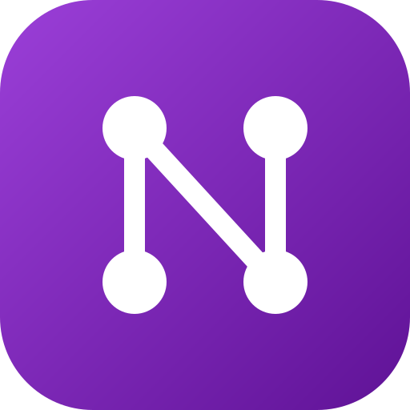
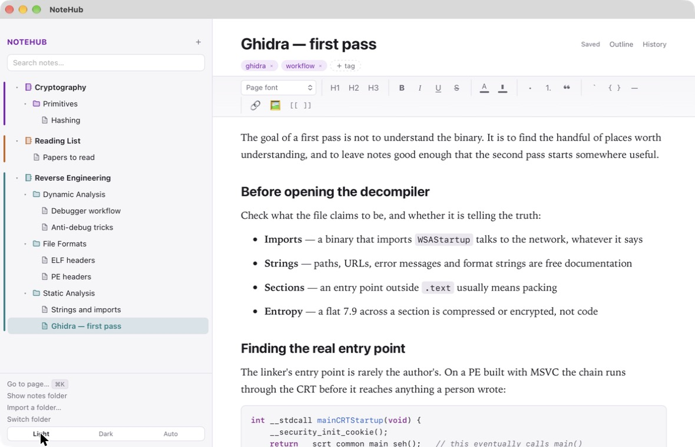

<div align="center">



# NoteHub

**A notebook that leaves your notes alone.**

Your notes are plain Markdown files in a folder you choose.
No account, no ads, no subscription, no telemetry.

[**Download for macOS**](https://github.com/TurbanTrap/notehub/releases/latest) ·
[**Download for Windows**](https://github.com/TurbanTrap/notehub/releases/latest) ·
[All releases](https://github.com/TurbanTrap/notehub/releases)


<br><br>

<picture>
  <source media="(prefers-color-scheme: dark)" srcset="docs/images/screenshot-dark.jpg">
  
</picture>

</div>

---

## Why

Note apps have a habit of growing into something else — a subscription, an inbox, a
feed, a place your work is *held*. NoteHub is deliberately none of that.

|  | |
|---|---|
| **No account** | Nothing to sign up for. Open it and start typing. |
| **No ads, ever** | Nothing is sold, promoted or recommended to you. |
| **No subscription** | Free in full. There is no paid tier holding a feature back. |
| **No telemetry** | It makes no network requests. Nothing about you leaves the machine. |
| **Works offline** | Always. There is no server for it to be cut off from. |
| **No lock-in** | Your notes are ordinary `.md` files. Delete the app and they are all still there. |

## What it does

- **Notebooks, sections and pages.** Sections nest as deep as you like; a page is a
  document written top to bottom.
- **A real editor.** Headings, lists, tables, bold and italic, text colour and a
  highlighter, code blocks with syntax highlighting, images you can resize and wrap
  text around.
- **Links between notes.** `[[Another Page]]` links two notes, and every page shows
  what links back to it.
- **Search that keeps up.** Full-text across the vault, plus tags and a <kbd>⌘K</kbd>
  jump-to-page.
- **History on every page.** Earlier versions are kept on your machine as you work, so
  a bad edit is never final. Restoring can itself be undone.
- **Sync with what you already use.** Put the folder in iCloud Drive, Dropbox or
  Syncthing.
- **Import what you have.** Point it at a folder of Markdown and it becomes a notebook,
  nesting and all.
- **Mac and Windows**, from the same vault.

## Installing

Download the file for your system from the
[latest release](https://github.com/TurbanTrap/notehub/releases/latest):

| System | File |
|---|---|
| macOS (Apple silicon and Intel) | `NoteHub_<version>_universal.dmg` |
| Windows (64-bit) | `NoteHub_<version>_x64-setup.exe` |

### The first launch needs one extra step

Neither build is code-signed. Signing costs a yearly fee to Apple and to a Windows
certificate authority, and this app is free, so your system will ask once whether you
meant to open it.

- **macOS** — right-click **NoteHub** in Applications, choose **Open**, then **Open**
  again in the dialog.
- **Windows** — click **More info** on the SmartScreen notice, then **Run anyway**.

Only needed the first time. If you would rather not trust a stranger's binary — a
sound instinct — the source is right here and builds in two commands.

### Checking what you downloaded

Because the installers are unsigned, a file tampered with on its way to you looks
exactly like one that was not. Every release carries a `SHA256SUMS-*.txt` written by the
build itself, so you can tell the two apart:

```bash
# macOS
shasum -a 256 ~/Downloads/NoteHub_0.2.1_universal.dmg
```

```powershell
# Windows
Get-FileHash -Algorithm SHA256 $HOME\Downloads\NoteHub_0.2.1_x64-setup.exe
```

Compare the result against the line for that filename in the checksum file. If it does
not match, do not run it.

## Building it yourself

```bash
npm install
npm run tauri dev
```

Needs Node and Rust. On macOS, if `cc` reports an Xcode licence error, either accept it
once with `sudo xcodebuild -license`, or point the build at the standalone tools:

```bash
export DEVELOPER_DIR=/Library/Developer/CommandLineTools
```

For a release build:

```bash
npm run tauri build
```

The app bundle lands in `src-tauri/target/release/bundle/macos/NoteHub.app`. Copy it
out of `target/` before using it, since a rebuild wipes that folder.

The `.dmg` step at the end needs permission to control Finder (System Settings >
Privacy & Security > Automation), and fails without it. That failure does not affect
the `.app`, which is already built by then — a DMG is only needed to hand the app to
someone else. `npm run tauri build -- --bundles app` skips the step entirely.

### Windows installers

A Windows build has to happen on Windows, so it runs in GitHub Actions rather than on
this machine. Pushing a tag builds both platforms and opens a draft release:

```bash
git tag v0.2.1 && git push origin v0.2.1
```

Running **Installers** by hand from the Actions tab builds the same things and attaches
them to the run without publishing anything. Mac gets one universal `.dmg`; Windows
gets an `.msi` and an NSIS `.exe`.

## Tests

```bash
cd src-tauri && cargo test
npx vitest run
```

## How syncing behaves

A note can change while it is open — that is what a sync folder does. NoteHub watches
the vault and reacts rather than carrying on with stale text:

- **Nothing unsaved:** the arriving version simply replaces what is on screen.
- **Something unsaved:** the file that arrived is left untouched, and your text is
  written to a new page beside it, named `<page>.conflict-<date>.md`. Both versions are
  then in the sidebar. Nothing is merged automatically, because merging means guessing.

Each save is checked against a fingerprint of the file as it was loaded, so a clash is
caught even if the watcher misses an event.

**History** in a page's header lists earlier copies of its text, kept on this machine in
the app's data folder — outside the vault, so the sync folder never carries them, and
outside the cache folder, which the system may clear. One is kept every couple of
minutes while you work, and whenever a version arrives from elsewhere. Restoring puts
the text back and keeps what you were on, so it can be undone.

## Looks

**Light, Dark or Auto** at the bottom of the sidebar. Auto follows the system and is
what a fresh install uses; choosing one pins it for this machine only, since the
setting lives in the app rather than in the vault.

**Notebook colours** come from the ⋯ menu on a notebook or section. The colour runs down
the spine of that notebook in the sidebar, tints its icons and marks the open page, so a
vault with several notebooks reads as a shelf rather than a list. The name of the colour
is kept in `notebook.json`, so it travels with the notes.

**Panel widths** are yours to set — drag the line between the sidebar and the page, and
double-click it to go back to the default.

## Vault layout

```
<vault>/
  notebooks/
    Reverse-Engineering/
      notebook.json          { "title": "Reverse Engineering", "color": "teal" }
      Static-Analysis/
        section.json
        ghidra-basics.md
  .notehub/
    trash/
```

Each page is Markdown with a small YAML frontmatter block holding its id, title,
timestamps and tags. Filenames are ASCII slugs so the same vault opens on macOS and
Windows; the full title lives in the frontmatter. Deletes move items to
`.notehub/trash/` rather than destroying them.

## Licence

Copyright © 2026 TurbanTrap. All rights in NoteHub remain with the author.

NoteHub is free software: you can redistribute it and modify it under the terms of the
**GNU General Public License, version 3** or, at your option, any later version. It is
distributed in the hope that it will be useful, but WITHOUT ANY WARRANTY — without even
the implied warranty of MERCHANTABILITY or FITNESS FOR A PARTICULAR PURPOSE. See the
[LICENSE](LICENSE) file, or <https://www.gnu.org/licenses/>, for the full terms.

In plain terms: use it for anything, including at work, for free and forever. Change it,
and pass your changes on. The one condition is that if you distribute a modified
version, you publish its source under this same licence — so NoteHub cannot be taken,
closed up and sold back to the people it came from.
